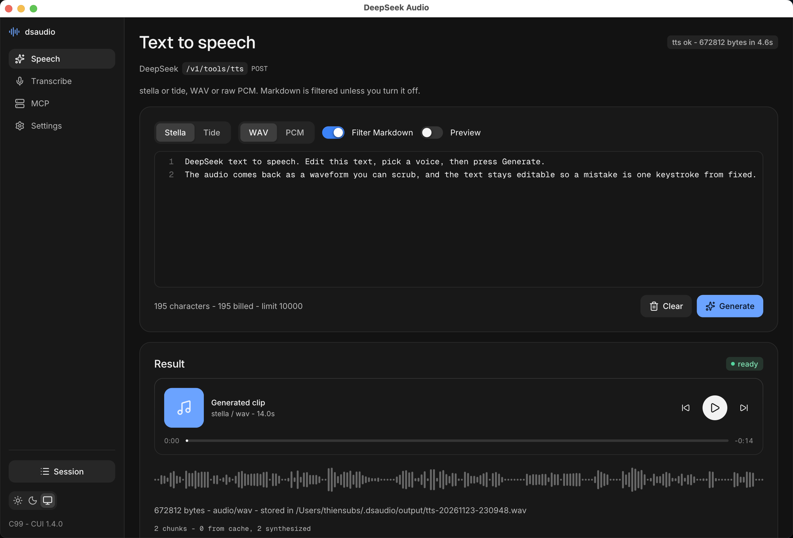
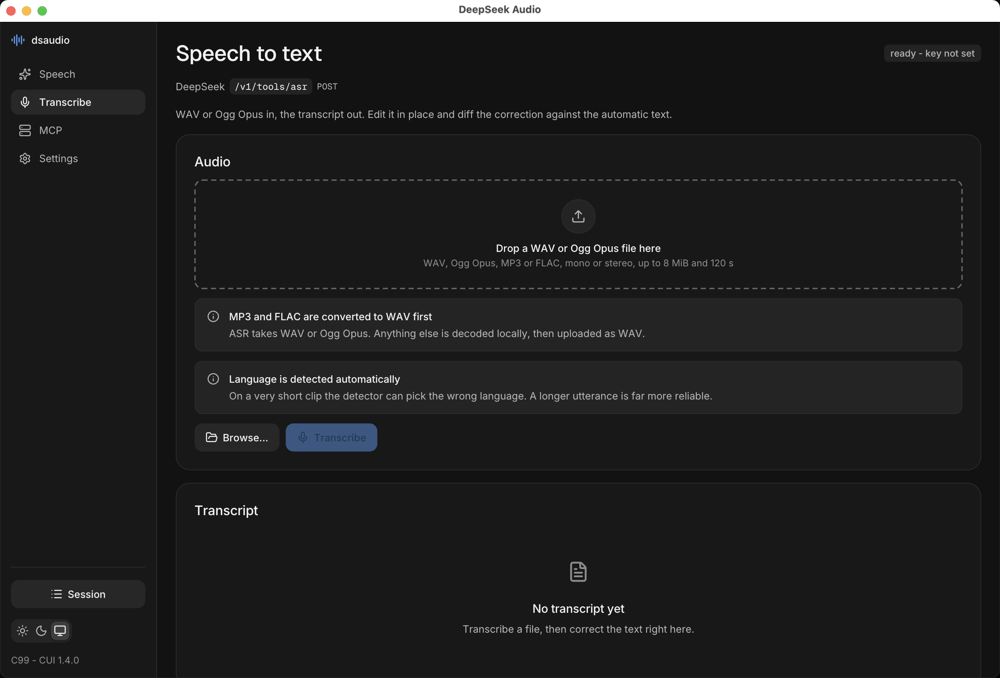
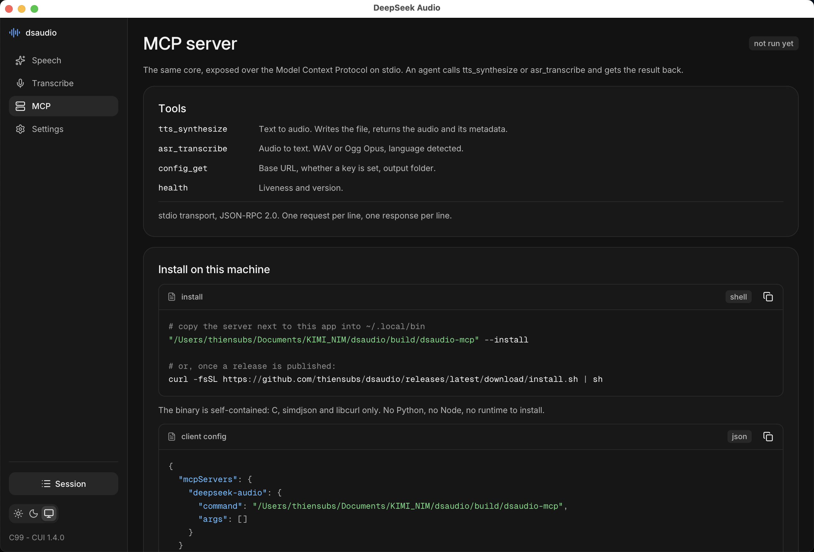
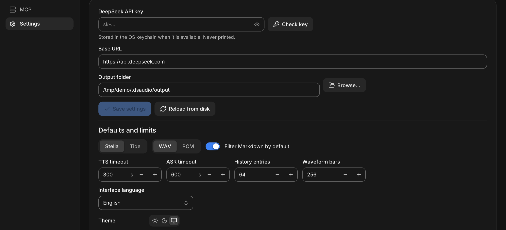
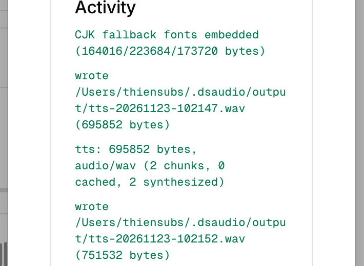

# dsaudio

DeepSeek TTS and ASR in one C application: a native workbench, a command line
tool and an MCP server, all sharing one core.

```
dsaudio          the CUI workbench (TTS, ASR, MCP, settings)
dsaudio-cli      the same core without a window
dsaudio-mcp      the same core over the Model Context Protocol (stdio)
```

Nothing here is Python or Node at runtime. C99, libcurl, simdjson and miniaudio,
all vendored or system.

## What it looks like

The workbench has four views. Nothing on screen is hard-coded: every field is
editable in the app and stored in its own config file, and the key goes to the
OS keychain.



Long text is cut into sentence chunks and each chunk is cached by content hash.
Editing one sentence re-synthesizes only that chunk, so a mistake costs one
request instead of a full regeneration. This shot reads
`2 chunks - 0 from cache, 2 synthesized`; running the same text again is a cache
hit and spends no tokens at all.



MP3 and FLAC are decoded locally to WAV first, then uploaded. The transcript comes
back editable, so a misheard word is one keystroke from fixed, and the correction
can be diffed against the automatic text.



`dsaudio-mcp` exposes `tts_synthesize`, `asr_transcribe`, `config_get` and
`health`. Installation is one command with a copy button for the shell snippet
and one for the client config.



Key and its store, base URL, output folder, default voice and format, timeouts,
history size, waveform resolution and theme.

## Build

```sh
cmake -S . -B build -DCMAKE_BUILD_TYPE=Release
cmake --build build -j
```

Needs a C99 compiler, CMake 3.14+, libcurl development headers, and on macOS
Xcode command line tools. Outputs `build/dsaudio`, `build/dsaudio-cli`,
`build/dsaudio-mcp`.

## Binaries and timings

Measured on the 2026-11-23 build (macOS x86_64, Release, embedded fonts loaded).

| Application | Binary | Size | Time |
|---|---|---|---|
| `dsaudio` (workbench) | `build/dsaudio` | 2,508,584 B (2.4 MiB) | 4.49 s to a visible window, cold |
| `dsaudio-cli` | `build/dsaudio-cli` | 1,274,200 B (1.2 MiB) | 0.64 s for `config` |
| `dsaudio-mcp` | `build/dsaudio-mcp` | 1,273,776 B (1.2 MiB) | 0.60 s for `--selftest` |
| TTS, 2 chunks, cold cache | – | 3.49 s | 2 requests, 0 from cache |
| TTS, same text, warm cache | – | **0.54 s** | 0 requests, no token cost |
| TTS, one sentence edited | – | 3.49 s | 1 request, 1 chunk reused |
| ASR, 3 s clip | – | 1.2 s | 1 request |

The 4.49 s window is dominated by parsing the 1.4 MB of embedded fonts (Latin,
Vietnamese and the CJK fallbacks). Lazy-loading the CJK subsets only when a CJK
language is selected is the obvious next win.

## Import and export formats

| Direction | Formats |
|---|---|
| ASR import | WAV (16-bit PCM), Ogg Opus, and MP3 / FLAC (decoded locally to WAV first) |
| TTS / export | WAV and raw PCM (24 kHz mono 16-bit) |

There is deliberately **no MP3 encoder**: MP3 encoding means LAME (LGPL), and at these
clip sizes the win is small. Ogg Opus would be the licence-clean, better-quality
alternative and our own ASR re-ingests it, but it is not implemented yet.

## Chunked TTS: edit one sentence, pay for one sentence

`docs/tts-chunks-cold.png` and `docs/tts-chunks-edited.png` show the same text
before and after an edit. The text is split at sentence boundaries, each chunk
is cached by a hash of its text, and only the changed chunk is synthesized
again — the join is a 12 ms equal-power crossfade.



Measured: a 2-chunk text costs 2 requests cold, 0 requests warm, and 1 request
after one sentence changes. That is the whole point of the cache: the second
edit is free.

## Use

```sh
dsaudio-cli config                 # where the key comes from
dsaudio-cli tts "hello there"      # -> WAV in the output folder
dsaudio-cli asr clip.wav           # -> transcript on stdout
dsaudio                           # the window
```

The key is resolved in this order:

1. `$DEEPSEEK_API_KEY` / `$DEEPSEEK_BASE_URL`
2. `~/.config/dsaudio/config.json` (written by Settings in the app)
3. `[providers.DeepSeek]` in `~/.kimi-code/config.toml` — the existing key, read
   only, never written back

## Install the MCP server

```sh
curl -fsSL https://github.com/thiensubs/dsaudio/releases/latest/download/install.sh | sh
```

or, from a checkout:

```sh
build/dsaudio-mcp --install
```

Then add to any MCP client:

```json
{
  "mcpServers": {
    "deepseek-audio": { "command": "/Users/you/.local/bin/dsaudio-mcp", "args": [] }
  }
}
```

Windows: `irm .../install.ps1 | iex`.

## Tools

| Tool | What it does |
|---|---|
| `tts_synthesize` | text → audio file + audio content block |
| `asr_transcribe` | WAV/Ogg Opus → transcript |
| `config_get` | base URL, key presence, output folder |
| `health` | liveness + version |

## Documented limits (measured 2026-11-22)

- TTS: 10 000 billed characters, 64 KiB request body, 30 min of audio. A CJK
  character counts as two billed characters.
- ASR: 8 MiB, 120 s, upload within 10 min. WAV (16-bit PCM) or Ogg Opus.
- A response that ends early is treated as a failure, not as short audio.
- ASR language is auto-detected and is unreliable on very short clips.

## Layout

```
src/core/    buffers, simdjson layer, libcurl transport, config, tts, asr,
             audio peaks, playback, job thread, MCP tool catalogue
src/app/     the CUI workbench
src/mcp/     the MCP server
src/cli/     the command line tool
vendor/      CUI, simdjson, miniaudio
```
